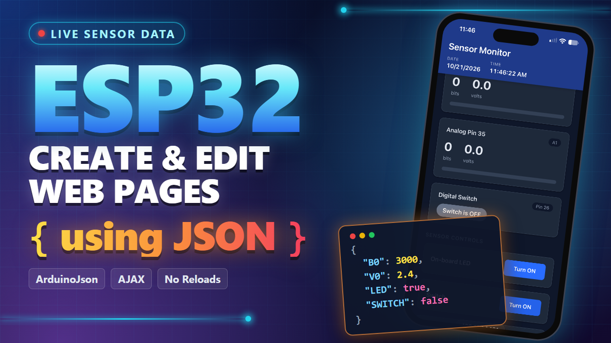
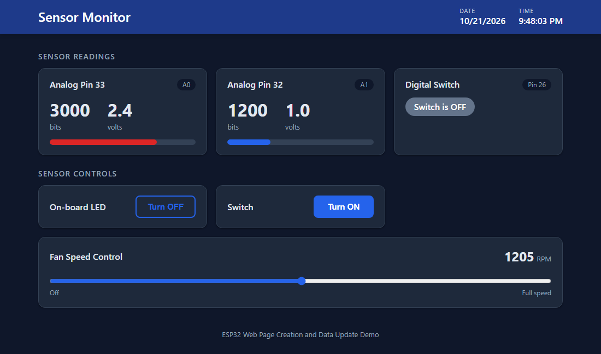
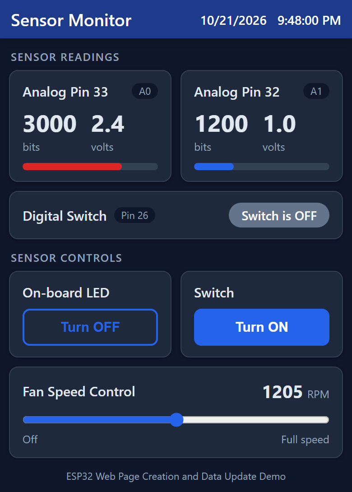

# ESP32: Create and Edit Web Pages Using JSON



> 🎬 **Video coming soon!** A YouTube video walking through this project (the code, the JSON data exchange, and the fan circuit) is on the way. A link will be posted here when it's live.

Host a modern, mobile-friendly web page on an ESP32 that shows **live sensor data** and lets you **control outputs** from any browser (PC, tablet, smartphone, or smart TV). Only the changed data is sent: the page asks the ESP32 for a small JSON message every 100 ms and updates values in place, with no page reloads and no flicker.

The JSON is built on the ESP32 with the excellent [ArduinoJson](https://github.com/bblanchon/ArduinoJson) library by Benoit Blanchon, and read in the browser with standard JavaScript (`JSON.parse`).

| Desktop | Phone |
|---|---|
|  |  |

## Features

- Live readings from 2 analog inputs (raw bits and volts) with color-coded bar graphs
- Toggle the on-board LED and a digital output from the web page
- Slider that sets a PWM fan speed and gets an immediate reply back from the ESP32
- JSON data transfer using ArduinoJson 7
- Modern page layout: cards, light/dark mode (follows your device setting), and a phone layout that fits on one screen
- Runs on your home Wi-Fi for easy development, or as a stand-alone access point
- Heavily commented code, written as a learning example

## How It Works

```
 Browser                                         ESP32
 ───────                                         ─────
 GET /                    ───────────────────►   SendWebsite()  sends the page (SuperMon.h)
 PUT /json  (every 100 ms)───────────────────►   SendJSON()     builds JSON with ArduinoJson
            ◄───────────────────────────────     {"B0":3000,"V0":2.4,"B1":1200,"V1":1.0,"LED":true,"SWITCH":false}
 JSON.parse() and update just the changed values

 PUT /BUTTON_0            ───────────────────►   ProcessButton_0()  toggles the LED
 PUT /BUTTON_1            ───────────────────►   ProcessButton_1()  toggles the digital output
 PUT /UPDATE_SLIDER?VALUE=128 ───────────────►   UpdateSlider()     sets fan PWM, replies with RPM
```

| JSON key | Meaning | Type |
|---|---|---|
| `B0`, `B1` | Analog reading, 0 to 4095 (12 bit) | number |
| `V0`, `V1` | Analog reading in volts, rounded to 0.1 V | number |
| `LED` | On-board LED state | true / false |
| `SWITCH` | Digital output state | true / false |

## Hardware

- ESP32 dev board (for example ESP32-DevKitC / "ESP32 Dev Module")
- 2 analog sensors (potentiometers, light sensors, temperature sensors, or even just your finger on the pins)
- Optional fan circuit: small 12 V DC fan, 2N2222A NPN transistor, 470 Ω and 10 kΩ resistors, 1N4001 diode, 12 V supply

### Pin Assignments

| Pin | Use |
|---|---|
| GPIO 33 | Analog input A0 |
| GPIO 32 | Analog input A1 |
| GPIO 26 | Digital output (toggled by the "Switch" button) |
| GPIO 27 | Fan PWM output |
| GPIO 2 | On-board LED |

Change these with the `#define PIN_...` lines at the top of `WebPageUpdate.ino`. If you change the analog pins, also update the "Analog Pin" labels in `SuperMon.h`.

### Fan Circuit

The ESP32 can't power a 12 V fan directly, so GPIO 27 drives a 2N2222A transistor that switches the fan's ground.

```
                       +12 V  (12 V supply +)
                              │
              ┌───────────────┴───────────────┐
              │                               │
            ─────  ← stripe (cathode)       ┌─┴─┐  red (+)
              ▲     1N4001 flyback diode    │ M │  12 V DC fan
              │                             └─┬─┘  black (−)
              └───────────────┬───────────────┘
                              │
                              │ C
                            │/
  ESP32 GPIO 27 ──[ 470 Ω ]──┬──B─┤   2N2222A (NPN)
                             │    │\
                          [10 kΩ]   ▼ E
                             │      │
  ESP32 GND ─────────────────┴──────┴─────────  12 V supply (−)
```

- The **flyback diode is required**. Without it, the voltage spike when the fan switches off can destroy the transistor.
- The **ESP32 GND and the 12 V supply (−) must be connected**, or the transistor won't switch.
- Never connect 12 V to an ESP32 pin.
- **Check your transistor's pinout!** It varies by manufacturer. With the flat face toward you and legs down, a PN2222A is **E-B-C**, but an ON Semi P2N2222A is **C-B-E**. See [Troubleshooting](#troubleshooting).
- The 470 Ω base resistor suits fans up to about 150 mA. For larger fans, use a logic-level MOSFET such as the IRLZ44N.

## Software Setup

1. Install the [Arduino IDE](https://www.arduino.cc/en/software).
2. Install the ESP32 boards package (**Tools → Board → Boards Manager**, search for "esp32" by Espressif). The code uses the version 3.x API (`analogWrite`, `analogWriteFrequency`).
3. Install **ArduinoJson** version 7.x (**Tools → Manage Libraries**, search for "ArduinoJson" by Benoit Blanchon).
4. Open `WebPageUpdate/WebPageUpdate.ino`.
5. Enter your Wi-Fi name and password:
   ```cpp
   #define LOCAL_SSID "your_home_ssid"
   #define LOCAL_PASS "your_home_password"
   ```
6. Board settings: **ESP32 Dev Module**, upload speed 921600, CPU 240 MHz, flash 80 MHz, QIO, 4 MB, default partition scheme.
7. Upload, open the Serial Monitor at **9600 baud**, and browse to the IP address it prints.

### Home Wi-Fi vs. Access Point

- With `#define USE_INTRANET` (the default), the ESP32 joins your home Wi-Fi. This is the easiest way to develop: edit, upload, refresh the browser.
- Comment out `USE_INTRANET` and the ESP32 creates its own network named `TestWebSite` (password `023456789`). Connect to it and browse to `192.168.1.1`.

### Debug Output

Uncomment `#define DEBUG` to print every JSON message to the Serial Monitor.

## Project Structure

```
WebPageUpdate/
├── WebPageUpdate.ino   ESP32 code: Wi-Fi, web server, sensor reads, JSON building
└── SuperMon.h          The web page: HTML, CSS, and JavaScript stored in a char array
Images/                 Screenshots and thumbnail used in this README
```

## Adding Your Own Data

Sending a new value to the page takes 3 small edits.

1. **ESP32 (`SendJSON()` in `WebPageUpdate.ino`):** add the value to the JSON document.
   ```cpp
   doc["TEMP"] = Temperature;
   ```
2. **HTML (`SuperMon.h`):** add an element with an `id` to show it.
   ```html
   <div class="value" id="temp">--</div>
   ```
3. **JavaScript (`response()` in `SuperMon.h`):** copy the value from the JSON to the element.
   ```javascript
   document.getElementById("temp").innerHTML = data.TEMP;
   ```

To send commands from the page to the ESP32, add a `server.on("/MY_COMMAND", MyFunction);` handler and call it from JavaScript the same way `ButtonPress0()` does. Every handler must call `server.send(...)`, even with an empty reply, to keep the page responsive.

**Tip:** to work on the page layout without uploading, copy everything from `<!DOCTYPE html>` to `</html>` in `SuperMon.h` into a `.html` file and open it in your browser. Press F12 for developer tools. The values show `--` without an ESP32, but you can see and tweak the layout.

## Troubleshooting

**The ESP32 won't program.**
Hold the BOOT button while the IDE is "Connecting...". A 10 µF electrolytic capacitor between EN and GND makes this automatic on many boards.

**The page doesn't load after editing `SuperMon.h`.**
ESP32 strings are limited to 64K by default. If your page grows past that, increase the limit in the ESP32 core's `WString.h`, found under
`C:\Users\<you>\AppData\Local\Arduino15\packages\esp32\hardware\esp32\<version>\cores\esp32\WString.h`. Around line 335:
```cpp
CAPACITY_MAX = 85000
//CAPACITY_MAX = 65535
```
This file is replaced when you update the ESP32 core, so you'll need to redo the change after an update.

**The Serial Monitor says "JSON buffer is too small".**
Increase the size of `char JSONTxt[256];` in `WebPageUpdate.ino`.

**The fan never stops, even with the transistor's base grounded.**
The transistor's collector and emitter are probably swapped (see the pinout note in [Fan Circuit](#fan-circuit)). In reverse, the 2N2222A's emitter-base junction breaks down at about 6 V and keeps the fan running at reduced speed. Rotate the transistor 180°. To find the pins with a meter's diode test, the base reads about 0.6–0.7 V to both other pins, and the emitter usually reads slightly higher than the collector.

**The fan barely changes speed.**
Small brushless fans have internal electronics with a capacitor that can ride through PWM. Experiment with the PWM frequency (`analogWriteFrequency(PIN_FAN, ...)` in `setup()`). Lower frequencies (20–100 Hz) often give more speed control at the cost of some ticking. Most small fans also won't run reliably below about 30% duty.

## Credits

- Code by Kris Kasprzak
- [ArduinoJson](https://github.com/bblanchon/ArduinoJson) by Benoit Blanchon

## License

MIT License. See [LICENSE](LICENSE). If you develop an application or product using this code and make millions of dollars, I'm happy for you!
